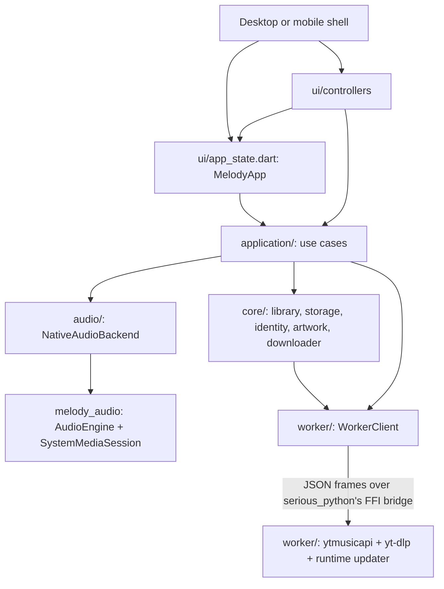

# Architecture and invariants

Melody is a Flutter application. Dart owns the UI, the application lifecycle,
durable state, the library, the queue, playback policy, download coordination,
and artwork verification. Python runs exactly one thing: the worker in
`worker/`, which hosts ytmusicapi and yt-dlp, embedded with
[serious_python](https://pub.dev/packages/serious_python)
and reached only through `app/lib/worker/`. Audio playback and system media
controls live in the repository-owned `packages/melody_audio` plugin.

## Where things live

| Concern | Location |
| --- | --- |
| Entry point, startup, app lifecycle | `app/lib/main.dart` |
| Service composition (stores, library, worker, coordinators) | `app/lib/services.dart` |
| Flutter UI: shells, pages, widgets, dialogs | `app/lib/ui/` (`desktop/`, `mobile/`, `shared/`) |
| UI state and feature workflows | `app/lib/ui/app_state.dart`, `app/lib/ui/controllers/` |
| Application use cases | `app/lib/application/` |
| Domain capabilities | `app/lib/core/` |
| Python boundary (FFI transport, typed client) | `app/lib/worker/` |
| Audio adapter onto the plugin | `app/lib/audio/` |
| Per-platform data, music, and FFmpeg paths | `app/lib/platform/` |
| Audio engine, media session, Android folders (Dart + Kotlin) | `packages/melody_audio/` |
| Python code | `worker/src/melody_worker/` (entry point `worker/src/main.py`) |
| Native runner projects | `app/{android,linux,macos,windows}/` |
| Tests | `app/test/`, `packages/melody_audio/test/`, `worker/tests/`, `tools/tests/` |
| App icons | The runner projects |
| Build, development, and validation tooling (`uv run melody-*`) | `tools/{build,dev,checks}/`, `.github/workflows/` |

Generated files are not committed: the Flutter `ephemeral/` folders, the
generated plugin registrants for Android, `.dart_tool/`, and the FFmpeg
and Python staging under `app/media/`, `app/build/`, and
`app/android/app/src/main/jniLibs/`. The desktop plugin registrants are
committed, as Flutter's templates expect, and so are the `pubspec.lock` and
`uv.lock` files.

## Dependency rules

- `core/` owns independently usable capabilities: SQLite and filesystem
  primitives (`storage.dart`), the music library (`library/`), canonical media
  identity (`media.dart`), embedded-artwork reading, failure classification
  (`errors.dart`), and the downloader. It never imports `application/` or UI.
- `application/` owns use cases that cross capabilities: the application store
  and settings models, the YouTube Music catalog, saved lyrics, the download
  coordinator, the library service, the queue and playback controller, the
  sleep timer, the thumbnail cache, cookie validation, the ytmusicapi and yt-dlp runtime
  status, and upgrades of older storage layouts (`storage_upgrade.dart`).
  It never imports UI.
- `services.dart` opens everything in order and exposes it as `AppServices`.
- `ui/app_state.dart` (`MelodyApp`) is the UI's root state: messages,
  navigation, panels, system media synchronization, follow-ups for requested
  downloads, and the feature controllers. Controllers receive `MelodyApp`, so
  the two reference each other; the cycle stays inside `ui/`.
- `ui/desktop/` and `ui/mobile/` never import each other. Both use
  `ui/controllers/` and `ui/shared/`.
- Only `worker/` talks to Python, and only `audio/` talks to the audio plugin.
- `worker/` (Python) contains no application policy. It receives yt-dlp
  options and ytmusicapi call arguments from the app, returns trimmed info
  dictionaries, JSON-safe ytmusicapi replies, and raw failure facts, and
  streams download progress. Option building, result mapping, and failure
  classification are Dart.

## The Python boundary

Python remains for what has no Dart equivalent: ytmusicapi (YouTube Music's
private API: song search, radio, playlists, lyrics), yt-dlp
(downloads), and choosing the release of each to import (the updater must run
inside the interpreter, before the first import). Everything else is Dart.

`WorkerClient` (`app/lib/worker/worker_client.dart`) is the app's only API to
Python. It is a small typed request/response client; nothing else sees frames,
ports, or the interpreter. `transport.dart` holds the two transports:

- `BridgeTransport`: the embedded interpreter, started with
  `SeriousPython.run` and reached through serious_python's in-process
  `PythonBridge` (`dart:ffi` calls into `libdart_bridge`; no sockets or
  subprocess). Frames are UTF-8 JSON byte buffers; serious_python copies each
  one into native memory and frees it, so no buffer ownership crosses the
  boundary.
- `ProcessTransport`: a standalone interpreter speaking newline-delimited JSON
  on stdio, used by integration tests and source-tree development
  (`MELODY_WORKER_PYTHON`).

### Protocol

Requests are `{"id", "op", ...}`; each gets exactly one
`{"id", "ok": true, "result"}` or `{"id", "ok": false, "error"}` reply. The
worker also emits `{"event": "ready", "status"}` once and
`{"event": "progress", "task", ...}` during downloads.

| Operation | Purpose |
| --- | --- |
| `ytmusic` | `YTMusic().<method>(**arguments)` for `search`, `get_watch_playlist`, `get_lyrics`, or `get_playlist`, as JSON |
| `extract` | `YoutubeDL(options).extract_info(target, download=False)`, trimmed to a few fields. Only the `melody-worker` console uses it, to diagnose yt-dlp; the app does not |
| `download` | Run yt-dlp into a staging directory owned by the app, emitting `progress` events; optional `metadata` (such as `lyrics`) becomes tags FFmpegMetadata writes |
| `tag` | Copy an audio file with FFmpeg (through yt-dlp, so `ffmpeg_location` applies), keeping every stream and tag and setting `metadata` tags such as `lyrics` |
| `cancel` | Stop a download at its next progress hook; never queued behind other work |
| `latest_release` | Newest compatible release of `package` (`yt-dlp` or `ytmusicapi`) on PyPI (Settings → Maintenance) |

Failures carry the exception chain's messages, types, errno values, and status
codes, so `core/errors.dart` can classify them without Python policy.

### Lifecycle

1. **Start.** `AppServices.load` calls `WorkerClient.start`, which never
   throws. The worker gets each package's runtime folder and whether to
   install a scheduled update through environment variables, selects yt-dlp
   and ytmusicapi on a background thread, and sends `ready` with a
   `WorkerStatus` holding one selection per package.
2. **Requests.** Frames sent before the worker registers its handler are
   queued and delivered in order. Python runs requests on a bounded thread
   pool; the app enforces the user's download concurrency.
3. **Failure.** The transport's `stopped` future completes when the
   interpreter fails to start (`SeriousPython.run` reports a failure or
   throws), when queued frames cannot be delivered for 30 seconds after the
   interpreter started, or when the development process exits. The client then
   fails every waiting request with a `WorkerFailure`, answers `ready` with an
   unavailable status (Settings shows it), and fails new requests immediately.
   Nothing waits forever, and the rest of the app keeps working.
4. **Process reuse (Android).** If the OS keeps the process, and so the
   interpreter, alive across a Dart VM restart, the transport does not start
   Python again. It calls `DartBridge.signalDartSession({"worker": port})`;
   the worker's restart handler serves the new port, drops replies to requests
   from the old session, cancels its downloads, and sends `ready` again.
5. **Shutdown.** CPython cannot be finalized and restarted safely in one
   process, so the interpreter lives until the process exits. On close the app
   cancels its downloads (each stops at its next progress hook) and stops
   listening.

serious_python changes the working directory to `<application support>/data`
when it starts Python. Melody uses absolute paths everywhere.

## The audio boundary

`melody_audio` exposes typed Dart APIs; the app's `NativeAudioBackend` adapts
them to the playback controller.

- `AudioEngine` is the process-scoped just_audio player. Requests (`setQueue`,
  `updateQueue`, `play`, `seek`, ...) carry an even generation
  chosen by the app; it reports `AudioEngineEvent`s (`AudioLoaded`,
  `AudioPositionChanged`, `AudioTrackChanged`, ...) tagged with their
  generation. Transitions the engine makes by itself use odd generations.
- `SystemMediaSession` publishes a `MediaSessionState` to lock-screen,
  notification, and desktop controls, and routes `MediaCommand`s: the engine
  carries out transport commands itself, and only commands that need
  application policy (favorite, shuffle, repeat) reach the
  app.
- `AndroidPlatform` is the Kotlin MethodChannel for the directories Melody
  needs from Android and for opening the Music folder in the Files app.

## State ownership

| State | Authority | Other participants |
| --- | --- | --- |
| Durable queue mirror, requested transport, current selection | `PlaybackController` | UI sends commands; native snapshots are persisted |
| Live queue, automatic transitions, decoder/device state | `AudioEngine` (melody_audio) | `NativeAudioBackend` forwards generation-filtered events to the controller |
| Track UUIDs, file references, hashes, playlists | `MusicManager` (`library.db`) | Services coordinate registration and deletion through `mutation` |
| Settings, track details, history, session queue, download history | `ApplicationStore` (`library.db`) | Writes commit atomically; failure restores in-memory values |
| Staged download files, cancellation, terminal outcome | `Downloader` | The worker writes only inside the staging directory it is given (and yt-dlp's cache folder, also chosen by the app) |
| Download reuse, registration, retry, resuming after a restart | `DownloadCoordinator` | Core does not know about the library; status changes are saved at once and byte progress every few seconds (a download active at startup carries on, and its row shows how far it had got) |
| Embedded cover artwork | The downloaded media container | The downloader reads it back before committing the file |
| Cover art for the UI, one file per track ID | `ThumbnailCache` | Read from the track's own file: when a download is registered or a file imported, else by the background pass after launch (`LibraryService.readMissingMetadata`), which covers earlier imports and a deleted cache. An empty entry records a file without art, so it is not read again. Entries of removed tracks go with them and at launch (`LibraryService.removeUnusedCaches`) |
| Runtime ytmusicapi and yt-dlp selection | `worker/src/melody_worker/updater/`, once per launch before import | `PackageRuntime` (one per package) schedules updates and reports status |
| Saved lyrics, keyed by media identity | `LyricsLibrary` (`lyrics/<provider>_<id>.json`) | Saved on download completion and first play; keeps lyrics showing for files that do not hold them; tracks without lyrics are rechecked weekly |
| Lyrics embedded in downloaded audio | The media file, written in staging before artwork verification and hashing | MP3 gets a `USLT` frame from `core/id3_lyrics.dart` (FFmpeg can only write a non-standard `TXXX`); other formats get FFmpeg's tag through the worker |
| Lyrics written into older library audio (desktop) | `LyricsEmbedder`, when asked in **Settings → Maintenance** | Written into a `.melody-tmp-*` copy, swapped in under the library mutation lock, then rehashed; a playing file or one that cannot take lyrics is left as it is and counted in the result; Loudness is measured again for a rewritten file |
| Loudness measurements and normalization gains | `LoudnessNormalizer` (`application/loudness.dart`), cached in `cache/loudness.json` by track ID with the file's size and modification time | FFmpeg's `ebur128` filter measures integrated loudness and true peak (`core/loudness.dart`), one file at a time in its own process, from 10 seconds after launch, for new tracks, and for what plays next; a file whose size or time changed is hashed first (its audio packets, with FFmpeg's `streamhash`, no decoding), so a rewrite of only tags, lyrics, or cover art keeps its measurement and only new audio is measured again; a corrupted or unsupported one is recorded so it is not retried until it changes; each `AudioQueueItem` carries its gain, which the engine multiplies with the volume |
| `.lrc` files beside library audio | Read by `LyricsLibrary`; no longer written | Melody's old ones (marked `[re:Melody]`) are removed when that pass finds the audio carries the lyrics; a user's `.lrc` is never changed; deleting or replacing the audio removes it; imports copy a `.lrc` beside the original |

Earlier releases kept the application's state in `state.db`. The next launch moves
it into `library.db` in one transaction, before anything opens either (a failure
leaves both as they were, and Melody says so), and keeps the old file for one more
launch. This is one-way: an earlier release opening `library.db` finds its tracks
but not its settings. Beyond that the library's schema only gained
`playlists.source`. Fixtures written by earlier releases are part of the test
suite. The `playback` row holds the queue and repeat mode, and the small
`playback_position` row holds the place in the queue, laid over it when read, so
moving through the queue never rewrites the queue. A `playback` row saved before
that split holds the place itself and reads the same way. An earlier release
ignores the second row, so it keeps the queue and loses the place. Melody
upgrades from 1.0.2, the first release with SQLite and this layout. It refuses a
data folder older than that (`state.json` or `library.mmdb` with no database)
and asks for 1.0.3 first, rather than start an empty library beside it.

### Playback

The controller owns durable playback intent and mirrors the engine's live
queue selection. `playing` reflects requested playback while a load is pending
and is reconciled by engine events; it is not proof that sound was emitted.
A row that fails while playing is skipped with a message, so one bad file does
not end the queue. Three skips in a row with nothing played stop playback, since
that points at the player rather than the files.

The controller gives the engine the whole queue as a list whose rows are built
when read, and the engine gives its decoder only the playing row and the next
`AudioEngine.upcomingRows`, so what a selection or an edit costs does not grow
with the queue. just_audio owns decoding, buffering, and gapless transitions;
`audio_session` configures focus and interruptions. Events from a superseded
generation are ignored, and completion is handled once per generation. Source
and transport commands are serialized separately so Pause stays responsive
while a replacement source prepares, and a load watchdog reports a decoder that
never becomes ready.

The decoder's playlist is linear and changes only after the playing row:

- **A selection** (a tapped row, Next or Previous in the app) prepares a new
  decoder with those rows beside the active one and swaps it in when ready, so
  the old track plays until then.
- **An edit** (add, remove, reorder, repeat mode) never replaces the decoder or
  touches the playing row. `AudioEngine._applyRows` compares what follows it
  with what the queue says should, removes from the first difference, and
  appends one row at a time, the only insertion every backend does correctly
  (just_audio_media_kit cannot insert within a playlist). A change past the
  window needs no native call. Passes run one at a time per decoder; a
  transition during one is followed by the next.
- **A transition** slides the window: it appends what is now in range. Played
  rows stay behind the playing one until the next selection, because removing
  them would shift its index under the decoder's asynchronous events.
- **Repeat queue** appends the first rows again instead of using a native loop
  mode, so the same mechanism wraps. Repeat track uses the decoder's own loop.
- **System controls:** Next moves along the decoder's playlist. Previous rewinds
  there, but an earlier row is not in it, so the app selects that row.
- **A removed playing track** keeps playing, outside the queue (row -1), and is
  followed by the row after it.
- **A decoder that runs out of rows** while the queue has more (this isolate
  fell behind, or an edit removed the row it had just moved to) continues with
  the next row rather than reporting completion.
- **A finished queue** stays stopped when rows are added. The edit waits, since
  appending to a finished media_kit decoder would start the row and leave it
  unable to advance or report completion. Play or Next moves on to the new row,
  releasing that decoder first on desktop.

The controller must not independently advance a native completion. Pause keeps
the media session; only Stop releases the decoder, keep-alive resources, and system
controls. Stop keeps the queue, rewound to the start of its current row, so Play
starts that row again. On Android the launcher activity is `singleTask` and caches its
Flutter engine, so removing the task does not destroy the decoder while the
foreground media service keeps the process alive. Full process death still
loses decoder identity; the persisted queue can be restored, but automatic
continuation is not claimed. Physical-device testing is still required for
background, lock-screen, and lifecycle behavior.

Loudness normalization never changes files or the saved volume. Each row's
gain is a linear amplitude factor. It reaches the target loudness while keeping
the true peak at or below -1 dBTP, and it raises quiet tracks by at most
`AudioEngine.maxBoostDb` (12 dB on Android, 6 dB on mpv, 0 where the decoder
only attenuates). Where the engine limits a boost's peaks
(`AudioEngine.limiterHeadroomDb`, 6 dB on Android), a boost may take them that
far over the ceiling, so quiet tracks with near-full-scale peaks are still
raised; cuts never rely on the limiter, which only runs while boosting. The
engine turns volume × gain into a decoder level, because the decoders differ:

| Platform | Decoder level | Boost |
| --- | --- | --- |
| Android (ExoPlayer) | Volume is linear amplitude, at most 1 | Above 1, full volume plus the same gain from an `AndroidLoudnessEnhancer` on the decoder's audio session, whose compressor keeps the boosted peaks from clipping; the effect is switched off whenever nothing is boosted |
| Windows, Linux (media_kit) | mpv plays `(volume/100)^3`, so the gain's cube root scales the volume | Volumes up to mpv's 130%; +6 dB at full volume is 126%. The bundled libmpv has no FFmpeg filters, so there is no limiter and a boost must fit under the track's peaks |
| macOS (AVPlayer) | Linear amplitude, at most 1 | None: quieter tracks play unchanged |

just_audio has no per-source volume, and the engine hears of a gapless
transition only after it is audible. So the engine schedules the change from
the playhead instead. A quieter next row is reached over the last 150 ms of the
outgoing track; a louder one switches at the boundary. The plan is redone on
every play, pause, seek, playback event, queue edit, and volume change, and an
approach that does not end in a transition is undone. An explicit selection
starts at its own gain. A measurement that arrives while a track plays applies
from its next play. Switching normalization or the target fades the playing
track over 1.5 seconds. Unmeasured and unmeasurable tracks use
the median gain of the measured library, and silent tracks are left alone.

Shuffle is a one-time in-place reorder of the whole queue: the current track
moves to the top and stays current, and every other row follows it, whether it
has played or not. An edit like any other, it never replaces the decoder, and it
can be undone. A tap on a row of any track list replaces the queue with that list
and plays from the row. Play on a search result instead joins the queue after
the current row, so the listener returns to the queue afterwards; a song still
downloading leaves the current music playing, and any selection or transport
command made meanwhile supersedes the request. Next, Previous, repeat, persistence, and
the queue view then follow that visible order. Playlist order is separately
authoritative in `MusicManager`; reordering a playlist never replaces the
active queue.

### Downloads

A download still running when Melody closes stays active in `library.db`, and the
next launch carries on with it; only cancelling it ends it. Each song stages in
its own `downloads/staging/job-<song>` folder, so another attempt finds what the
last one left: yt-dlp continues a partial stream, and `final_ext` lets it skip a
song already downloaded. Before the download, the worker's `resume_guard` clears
half-written FFmpeg output, and partial streams of a format other than the one
chosen now, which yt-dlp would otherwise continue with the wrong bytes. That
folder stays when the app closes or dies, and through failures another attempt
may get past (network, rate limit, an outdated engine, cookies); it goes after
success, cancellation, and anything else, in case the bytes themselves caused
the failure. Off screen, Android runs a `dataSync`
foreground service for as long as any download is active, reported over the
`melody/downloads` channel.

Format, quality, the number of concurrent downloads, and cookies apply to
downloads that start after they change; a running download keeps what it started
with, and a higher limit starts waiting ones at once. Settings apply and are
saved the moment they change, except a new music folder, which can move the
whole library and so waits for a button and a confirmation.

An imported playlist keeps its link (`playlists.source`), in one canonical form.
Importing that link again, or Update on the playlist, fills the same playlist:
songs added there join it in their order, what failed or was interrupted gets
another try, and a name or tracks given here stay. Stopping an import keeps what
it has so far.

A download is one song. Its options set `noplaylist`, its source is stored as
`https://music.youtube.com/watch?v=<id>` whatever form the link took, and a link
that names no song (a playlist page) is refused. Playlists are imported instead,
which downloads each song as its own task.

Coordinator reservations use canonical source keys; requests for one source
share active work. File allocation, duplicate lookup, and registration are
serialized through `MusicManager.mutation`, including local imports. The
downloader runs `concurrent_downloads` jobs and queues the rest, so a batch of any
size waits its turn; a playlist import keeps only a window of its songs queued, so
a long playlist does not fill the history at once. Download options (format, quality, concurrency, folder,
cookies) are fixed when the coordinator opens, so changing them applies at the
next launch.

yt-dlp keeps the thumbnail sidecar in staging while metadata is written, and
the cover is burned in as the last postprocessor. Before promotion the
downloader reads the cover back from every audio file with `core/artwork.dart`
(ID3v2, MP4 `covr`, FLAC, Ogg Opus/Vorbis). A song without a readable cover is
still kept. The worker makes embedding optional (`optional_cover`), so a failure
there leaves the audio as it is; the image yt-dlp downloaded then fills the
thumbnail cache instead, and without either the song plays with a placeholder.

Promotion and registration are the last two steps, one right after the other.
If registering fails, the promoted file is removed and the download can be
retried. If the process ends between them, the download starts over at the next
launch and the promoted file stays, listed by Maintenance as not in the library.
A download registered just before the process ended is recognized by its source
and not repeated. Cancellation is
cooperative and decided once: cancellation accepted before completion wins and
cleans owned outputs.

### Storage layout

`AppPaths` (`app/lib/platform/paths.dart`) is the only place that names a
location. The data folder is the same in every release (see the README), so
installs upgrade in place; inside it:

| Path | Contents | Owner |
| --- | --- | --- |
| `library.db` | Tracks, file references, hashes, playlists; and settings, track details, history, queue, download history, small app state | `MusicManager`; `ApplicationStore` |
| `cookies.txt` | Uploaded cookies; present means yt-dlp uses them | Settings (upload/remove) |
| `music-move.json` | The files of a music folder move in progress | `MusicManager` |
| `lyrics/` | Saved lyrics, `<provider>_<id>.json` | `LyricsLibrary` |
| `downloads/staging/` | One locked `job-*` folder per running download | `Downloader` |
| `runtime/yt-dlp/`, `runtime/ytmusicapi/` | Runtime package updates, separate from the bundled copies | The worker's updater |
| `cache/artwork/` | Artwork copied out of audio files, `<track id>.thumb` | `ThumbnailCache` |
| `cache/yt-dlp/` | yt-dlp's player and signature cache (`cachedir`) | yt-dlp; pruned by `pruneYtDlpCache` |
| `cache/notification-artwork/` | Square crops for the system media controls | melody_audio; the 64 most recently used are kept |
| `cache/loudness.json` | Loudness measurements of library tracks | `LoudnessNormalizer`; removed tracks are dropped at launch |

Rules that keep it predictable:

- **Persistent, runtime, and cache data are separate.** Everything under
  `cache/` can be deleted while Melody is closed; it is rebuilt or fetched
  again. Deleting `runtime/` falls back to the bundled packages.
- **The music folder holds audio only.** Downloads stage in
  `downloads/` on every platform, and only finished audio is moved to the
  music folder (copied when it is on another volume). Melody's only other
  files there are `.melody-tmp-*` copies renamed into place.
- **One temporary-file convention.** Every atomic write and copy goes through
  `temporarySibling` (`.melody-tmp-<16 hex><extension>`, the extension kept
  for Android's `Music`), and `removeStaleTemporaries` recognizes exactly
  those names (plus the Python releases' `mkstemp` names).
- **Stored paths are relative where Melody owns the folder.** Library
  filenames are relative to the music folder, and are validated against traversal
  before use. Absolute paths remain only for the user-chosen music folder,
  imported originals, and Android tracks inside the public `Music` root.
- **Earlier layouts are upgraded in one place.** `storage_upgrade.dart` holds
  every name an earlier release used: it refuses a data folder too old to
  upgrade from, and removes what no release reads any more (the lyrics caches
  and `downloads/receipts/`).

### Disk cleanup

Every file Melody generates has one owner, and each owner removes it on every
outcome and again at the next launch if the process ended first:

- **Download staging.** A job holds an exclusive lock on
  `.melody-staging.lock` inside its staging folder, and a `finally`
  deletes the folder after completion, failure, or cancellation (once more
  two seconds later if a closing FFmpeg still holds a file). Closing the
  app mid-download ends the process before that runs, so
  `DownloadCoordinator.open` calls `Downloader.removeAbandonedStaging` before
  any job starts. It deletes staging whose lock it can take: the operating
  system releases a lock when its process ends, while another running
  Melody still holds its own. Staging without a lock is deleted once nothing
  in it has changed for an hour.
- **Removed tracks.** Deleting a track, clearing the library, and a
  download that repairs or duplicates a track all remove the audio Melody
  downloaded (with its `.lrc`) through `OwnedFiles`, which records each
  path before the entry changes and retries at every launch until the file
  is gone. Imported copies are kept unless the full reset asks otherwise.
  The artwork and saved lyrics of a removed track go with its last entry,
  and at launch if anything was missed.
- **Temporary files** (`.melody-tmp-*`, including the ID3 lyrics writer's)
  untouched for an hour are removed at launch from the data, lyrics, and
  artwork folders and from every folder holding library tracks
  (`removeStaleTemporaries`). Nothing else matches those names.
- **Music folder moves.** `MusicManager.moveMusicFolder` records its files
  in `music-move.json` first. If the process ends before the new folder is
  saved, the next launch moves them back to the saved folder (or, after a
  completed move, just deletes the journal).
- **Saved lyrics and cached artwork** that no library track uses (failed
  downloads, removed tracks) are removed at launch
  (`LibraryService.removeUnusedCaches`) and with the last track that uses
  them. Embedder records of removed tracks are dropped at launch.
- **yt-dlp's cache** lives in `cache/yt-dlp/` instead of `~/.cache/yt-dlp`.
  At launch, entries older than 30 days are removed, and then the oldest
  until the folder is at most 64 MB (`pruneYtDlpCache`).
- **Notification artwork** keeps the 64 most recently used crops, written
  atomically; an interrupted write is removed by the next prune.
- **Runtime packages.** The worker's updater keeps the current and previous
  release of each package and removes its own interrupted downloads.
- **Databases.** History lists are capped (250 downloads, 100 plays, 20
  searches), deleted tracks take their rows with them, and a database whose
  free pages exceed a quarter of a file of 4 MB or more is compacted
  (`VACUUM`) when it opens.

Cleanup never follows names alone into user data. Unregistered audio,
a user's `.lrc`, and imported originals are never deleted.

## Track identity and files

A library UUID is the durable identity of a saved record. Remote identity is
provider plus stable media ID (`MediaIdentity`); YouTube Music and YouTube
watch, short, live, embed, and youtu.be URLs normalize to `youtube:<id>`.
Titles and filenames never determine remote equality; local files use a
content hash.

An imported file's title, artist, and cover come from its tags, falling back to
its name, and tracks imported before that are filled in once by the background
pass; a title the user changed stays. A track whose length nothing has named gets
it the first time it plays.

A track counts as available while its file exists and is not empty. The recorded
hash only finds duplicates by content: a file edited elsewhere (new tags, say)
stays the track's own and is never replaced. Only a missing or empty file is
repaired by downloading the song again.

| File class | Owner and lifecycle |
| --- | --- |
| Download staging | `Downloader`-owned, locked `downloads/staging/job-*` folder, one per song; removed when a download ends, unless another attempt could carry on from it. At launch, one no active or failed download could use is removed once its process has ended, and any is removed after a week untouched |
| Completed, unregistered download | Removed if registering fails; if the process ends first, the file stays and Maintenance lists it |
| Managed library audio | `MusicManager`; desktop uses the music folder, on Android the music folder is inside public `Music` (`Music/Melody` by default); tracks earlier releases kept in private storage move there once at launch |
| Downloaded audio of a removed entry | `OwnedFiles`: recorded in `library.db` (`pending_file_deletions`) before the entry goes, then deleted with its `.lrc`; a file that cannot be deleted yet (held open, or a crash in between) is deleted at a later launch, unless an entry still uses it |
| Imported local original | The user's; Melody copies it and never deletes the original |
| Copied import, lyrics rewrite | A `.melody-tmp-*` file beside the destination; an atomic rename exposes only complete files; an abandoned one is removed at launch |
| yt-dlp cache | `cache/yt-dlp/`; disposable, pruned at launch by age and size |
| Cached artwork | `cache/artwork/`; derived from each track's file, pruned to the library's tracks |
| Uploaded cookies | `cookies.txt`; explicit upload/remove only (restoring default settings removes it) |
| Runtime yt-dlp wheels | `runtime/yt-dlp/`, separate from the bundled yt-dlp |
| Runtime ytmusicapi wheels and their extracted copies | `runtime/ytmusicapi/`, separate from the bundled ytmusicapi |
| Saved lyrics | `lyrics/`; written atomically; removed with the last track of the same song, and at launch when no library track uses them |
| `.lrc` beside an audio file | The user's (Melody's old ones are marked `[re:Melody]` and cleaned up); removed with its audio file |

## Crash consistency

The database uses write-ahead logging. A change writes only its rows in one
transaction; a failure rolls back and the owner restores its in-memory model.
`MusicManager` and `ApplicationStore` each have a connection to the file, because
durability is set per connection.
The library's commits are flushed to durable storage before they return
(`FULL`); application state uses `NORMAL`, which survives application crashes
and may lose only the latest session saves on power loss. Each database opens
with an integrity quick check. Cookies, saved lyrics, and
artwork are written to a `.melody-tmp-*` file, flushed, and renamed; a
temporary file a crash leaves behind is removed at a later launch.

A track's details go with it in one transaction (a trigger on `tracks`), so they
cannot outlive it. Other changes that touch both owners, such as registering a
track and then saving its details, are separate transactions. Startup marks completed
downloads whose library track lost its file as repairable (a track the user
removed is not lost), starts interrupted downloads over, and filters the
restored queue by file availability. `LibraryService.reconcile`
(Settings → Maintenance) removes stale secondary references and lists
unregistered files without deleting them.

## Keeping the UI isolate responsive

Everything below runs on the UI isolate unless it says otherwise, so slow
work stays out of builds and event handlers:

- Network, yt-dlp, and tagging run in the Python worker; audio decoding runs
  natively, and loudness measurement runs in an FFmpeg process (one at a
  time; the app reads only its summary).
- Hashing, file copies, artwork and lyrics tag reads, and MP3 lyrics writes
  run in `Isolate.run`. The lyrics writer keeps only the tag in memory and
  streams the audio through a fixed buffer.
- Library and state reads come from in-memory models; only writes reach
  SQLite, and library writes do not wait for the disk (see Crash
  consistency).
- `ThumbnailCache.open` lists the thumbnail folder once in a background
  isolate; afterwards artwork widgets and queue activation answer from
  memory, and the cache's own writes keep that index current.
- Startup checks many files at once with `existingFiles`, one background
  isolate for the whole batch (the resumed queue, completed downloads).
- Widgets do not touch the filesystem while building: a missing local
  artwork file shows the placeholder through the image's error path, and
  the cookie file's presence is checked when settings are opened.
- Playback position updates repaint only their own layer: `LivePosition` is a
  repaint boundary, and the seek bar's times sit in fixed boxes, because text
  that changes every second would otherwise lay out, and so repaint, everything
  above it. `screens_test.dart` counts what one update paints.
- Library reads stay cheap per row, because queue activation and long lists make
  thousands of them: canonical IDs skip UUID parsing, and sorted track orders
  are kept until the tracks change. Local lists have no pages: each builds only
  the rows in view, and takes their height from a prototype row, so a long list
  scrolls and jumps without measuring every row.
- Launch cleanup of cached artwork and saved lyrics runs in a background
  isolate, since it lists the folders and parses a URL for every library track.
- The background pass that reads covers and tags opens a few files at a time in
  a background isolate.

Known limits: opening the two databases (an integrity quick check and loading
the library model) is synchronous during the loading view, and a SQLite
checkpoint, about once per 1000 written pages, flushes on the committing
isolate. Both are bounded by the size of the databases, not by the music.

## Remaining engineering work

- Physical-device tests of the decoder window: gapless transitions with rows
  appended and removed on ExoPlayer and mpv, and playback continuing while the
  app is backgrounded on Android.
- Physical-device lifecycle tests for background playback, notification
  reattachment, and interpreter reuse on Android.
- macOS bundles copy FFmpeg into `Contents/Resources/ffmpeg` after
  `flutter build`; signing and notarization must cover those executables.
- A complete locked native dependency graph per target for reproducible
  artifacts.
