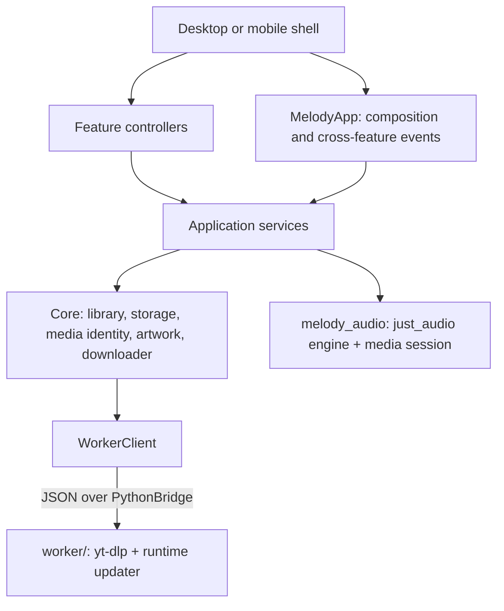

# Architecture and invariants

Melody is a Flutter application. Dart owns the UI, durable state, library,
queue, playback policy, download coordination, and artwork verification. An
embedded CPython interpreter (via serious_python) runs exactly one thing: the
yt-dlp worker in `worker/`. The audio engine and system media session live in
the repository-owned `packages/melody_audio` plugin. These are separate state
owners with explicit handoffs; fewer files are not a goal if they weaken those
boundaries.

## Dependency rules

- `app/lib/core/` owns independently usable capabilities: SQLite storage
  primitives, the music library, canonical media identity, embedded-artwork
  reading, failure classification, and the downloader. It does not import
  application services or UI.
- `app/lib/application/` owns use cases that cross capabilities: the
  application store, providers (yt-dlp option building and result mapping), the
  download coordinator, library service, queue, playback controller, thumbnail
  cache, cookie validation, and yt-dlp runtime status. It does not import UI.
- `app/lib/app/` composes services (`AppServices`) and holds application-wide UI
  state (`MelodyApp`): system media synchronization, media-session actions,
  pending download follow-ups, and Android Music export.
- `app/lib/ui/controllers/` contains the feature workflows that were the Flet
  page controllers (search, library, playlists and import, home
  recommendations, settings drafts). Both presentations share them.
- `app/lib/ui/desktop/` and `app/lib/ui/mobile/` must not import one another.
  Shared widgets, dialogs, menu actions, and settings sections live in
  `app/lib/ui/shared/`.
- `worker/` contains no application policy. It receives yt-dlp options from the
  app, returns trimmed info dictionaries and raw failure facts, and streams
  download progress. Classification, option building, and result mapping are
  Dart.

## The worker boundary

The app starts the worker with `SeriousPython.run` and talks to it over
serious_python's in-process `PythonBridge` (no sockets, no subprocess). During
development `MELODY_WORKER_PYTHON` runs the same code in a standalone
interpreter over newline-delimited JSON on stdio.

Requests are `{"id", "op", ...}`; each gets one `{"id", "ok", "result"|"error"}`
reply. Operations:

| Operation | Purpose |
| --- | --- |
| `extract` | `YoutubeDL(options).extract_info(target, download=False)`, trimmed to the fields Melody reads |
| `download` | Run yt-dlp into a staging directory owned by the app, emitting `progress` events |
| `cancel` | Stop a download at its next progress hook |
| `status` / `ready` event | The runtime selection result |
| `latest_release` | Newest compatible yt-dlp on PyPI (Settings → Maintenance) |

Failures carry the exception chain's messages, types, errno values, and status
codes so `core/errors.dart` can classify them without Python policy.

## State ownership

| State | Authority | Other participants |
| --- | --- | --- |
| Durable queue mirror, requested transport, current selection | `PlaybackController` | UI sends commands; native snapshots are persisted |
| Live queue, automatic transitions, decoder/device state | `NativeAudioRuntime` (melody_audio) | `NativeAudioBackend` forwards generation-filtered events to the controller |
| Track UUIDs, file references, hashes, playlists | `MusicManager` (`library.db`) | Services coordinate registration and deletion through `mutation` |
| Settings, track details, history, session queue, download history | `ApplicationStore` (`state.db`) | Writes commit atomically; failure restores in-memory values |
| Staged download files, cancellation, terminal outcome | `Downloader` | The worker writes only inside the staging directory it is given |
| Download reuse, registration, retry, receipts replay | `DownloadCoordinator` | Core does not know about the library |
| Embedded cover artwork | The downloaded media container | The downloader reads it back before committing the file |
| Offline UI artwork keyed by remote URL | `ThumbnailCache` | Derived only from verified embedded bytes |
| Runtime yt-dlp selection | `worker/melody_worker/updater.py`, once per worker launch before import | `YtDlpRuntime` schedules updates and reports status |

Both SQLite schemas are unchanged from the Python releases, and fixtures written
by the Python stores are part of the Dart test suite. Pre-SQLite `library.mmdb`
and `state.json` files are still imported once and kept with a `.migrated`
suffix.

### Playback

The controller owns durable playback intent and mirrors the native engine's live
queue selection. `playing` reflects requested playback while a load is pending
and is reconciled by native events; it is not proof that sound was emitted.

The controller always gives the complete library path queue to the native
engine. `just_audio` owns decoding, buffering, playlist transitions, and repeat;
`audio_session` configures focus and interruptions. Explicit requests use even
generations and native transitions odd ones, so events from a superseded decoder
are ignored; completion is handled once per generation. Source and transport
commands are serialized separately so Pause stays responsive while a replacement
source prepares, and a load watchdog reports a decoder that never becomes ready.

The controller must not independently advance a native completion. Queue
mutations replace or update the native queue atomically; system media controls
operate the engine directly and only actions the installed queue cannot satisfy
fall back to the app. Pause keeps the media session; only Stop releases the
decoder, keep-alive resources, and system controls. On Android the launcher
activity is `singleTask` and caches its Flutter engine, so removing the task does
not destroy the decoder while the foreground media service keeps the process
alive. Full process death still loses decoder identity; the persisted queue can
be restored, but automatic continuation is not claimed. Physical-device testing
is still required for background, lock-screen, and lifecycle behavior.

Shuffle is a one-time in-place reorder of the upcoming rows (or the whole
collection when starting shuffled). Next, Previous, repeat, persistence, and the
queue view then follow that visible order. Playlist order is separately
authoritative in `MusicManager`; reordering a playlist never replaces the
active queue.

### Downloads

Coordinator reservations use canonical source keys; requests for one source
share active work. File allocation, duplicate lookup, and registration are
serialized through `MusicManager.mutation`, including local imports. The
downloader's queue is bounded by `concurrent_downloads` active plus as many
pending jobs; overload is reported per song (`WorkerQueueFull`) without
cancelling a batch.

yt-dlp keeps the thumbnail sidecar in staging while metadata is written and the
cover is burned in as the last postprocessor. Before promotion the downloader
reads the cover back from every audio file with `core/artwork.dart` (ID3v2,
MP4 `covr`, FLAC, Ogg Opus/Vorbis); advertised artwork without a readable
embedded cover fails the download. Only verified bytes reach the thumbnail
cache.

Before completed files are promoted, a checksum receipt
(`.melody-download-<task>.json`) records their names, hashes, source, and task.
Registration acknowledges it; startup verifies and replays interrupted
handoffs and keeps malformed or mismatched receipts for repair. Cancellation is
cooperative and decided once: cancellation accepted before completion wins and
cleans owned outputs.

## Track identity and files

A library UUID is the durable identity of a saved record. Remote identity is
provider plus stable media ID (`MediaIdentity`); YouTube Music and YouTube
watch, short, live, embed, and youtu.be URLs normalize to `youtube:<id>`. Titles
and filenames never determine remote equality; local files use a content hash.

| File class | Owner and lifecycle |
| --- | --- |
| Preview stream | Ephemeral URL; never creates a library track |
| Download staging | `Downloader`-owned `.melody-download-*` directory; removed after every outcome |
| Completed, unregistered download | Its checksum receipt owns the handoff |
| Managed library audio | `MusicManager`; desktop uses the music folder, Android publishes to public `Music/Melody` and removes the private copy after the record is updated |
| Imported local original | The user's; Melody copies it and never deletes the original |
| Copied import staging | `.melody-import-*.tmp`; an atomic rename exposes only complete files |
| Uploaded cookies | Private application storage; explicit upload/remove only |
| Runtime yt-dlp wheels | `yt-dlp-runtime/`, separate from the bundled yt-dlp |

## Crash consistency

Both databases use write-ahead logging. A change writes only its rows in one
transaction; a failure rolls back and the owner restores its in-memory model.
The library commits with `synchronous=FULL`; application state uses `NORMAL`,
which survives application crashes and may lose only the latest session saves
on power loss. Each database opens with an integrity quick check. Cookies,
receipts, and thumbnails are written to a temporary file, flushed, and renamed.

The two databases are not a distributed transaction. Startup marks completed
history with missing audio as repairable, replays verified receipts, and filters
the restored queue by file availability. `LibraryService.reconcile` (Settings →
Maintenance) removes stale secondary references and lists unregistered files
without deleting them.

## Remaining engineering work

- Physical-device lifecycle tests for background playback and notification
  reattachment on Android and iOS.
- iOS cannot run FFmpeg as a subprocess, so downloads that require conversion
  are not available there yet.
- macOS bundles copy FFmpeg into `Contents/Resources/ffmpeg` after
  `flutter build`; signing and notarization must cover those executables.
- A complete locked native dependency graph per target for reproducible
  artifacts.
