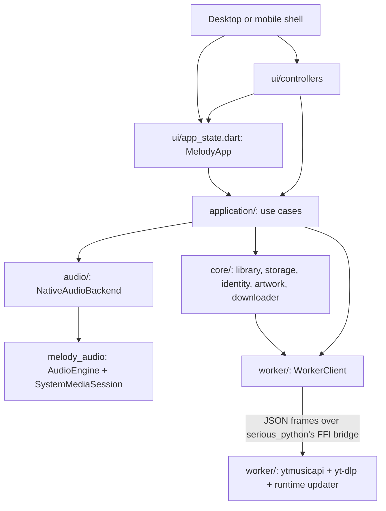

# Architecture and invariants

Melody is a Flutter application. Dart owns the UI, the application lifecycle,
durable state, the library, the queue, playback policy, download coordination,
and artwork verification. Python runs exactly one thing: the worker in
`worker/`, which hosts ytmusicapi and yt-dlp, embedded with
[serious_python](https://pub.dev/packages/serious_python)
and reached only through `app/lib/worker/`. Audio playback and system media
controls live in the repository-owned `packages/melody_audio` plugin.

## Where things live

| Concern | Location |
| --- | --- |
| Entry point, startup, app lifecycle | `app/lib/main.dart` |
| Service composition (stores, library, worker, coordinators) | `app/lib/services.dart` |
| Flutter UI: shells, pages, widgets, dialogs | `app/lib/ui/` (`desktop/`, `mobile/`, `shared/`) |
| UI state and feature workflows | `app/lib/ui/app_state.dart`, `app/lib/ui/controllers/` |
| Application use cases | `app/lib/application/` |
| Domain capabilities | `app/lib/core/` |
| Python boundary (FFI transport, typed client) | `app/lib/worker/` |
| Audio adapter onto the plugin | `app/lib/audio/` |
| Per-platform data, music, and FFmpeg paths | `app/lib/platform/` |
| Audio engine, media session, Android MediaStore (Dart + Kotlin) | `packages/melody_audio/` |
| Python code | `worker/src/melody_worker/` (entry point `worker/src/main.py`) |
| Native runner projects | `app/{android,linux,macos,windows}/` |
| Tests | `app/test/`, `packages/melody_audio/test/`, `worker/tests/`, `tools/tests/` |
| Assets | `packages/melody_audio/assets/` (saliency model); app icons in the runner projects |
| Build, development, and validation tooling (`uv run melody-*`) | `tools/{build,dev,checks}/`, `.github/workflows/` |

Generated files are not committed: the Flutter `ephemeral/` folders, the
generated plugin registrants for Android, `.dart_tool/`, and the FFmpeg
and Python staging under `app/media/`, `app/build/`, and
`app/android/app/src/main/jniLibs/`. The desktop plugin registrants are
committed, as Flutter's templates expect, and so are the `pubspec.lock` and
`uv.lock` files.

## Dependency rules

- `core/` owns independently usable capabilities: SQLite and filesystem
  primitives (`storage.dart`), the music library (`library/`), canonical media
  identity (`media.dart`), embedded-artwork reading, failure classification
  (`errors.dart`), and the downloader. It never imports `application/` or UI.
- `application/` owns use cases that cross capabilities: the application store
  and settings models, the YouTube Music catalog, saved lyrics, the download
  coordinator, the library service, the queue and playback controller, the
  thumbnail cache, cookie validation, the ytmusicapi and yt-dlp runtime
  status, and the Android Music export.
  It never imports UI.
- `services.dart` opens everything in order and exposes it as `AppServices`.
- `ui/app_state.dart` (`MelodyApp`) is the UI's root state: messages,
  navigation, panels, system media synchronization, follow-ups for requested
  downloads, and the feature controllers. Controllers receive `MelodyApp`, so
  the two reference each other; the cycle stays inside `ui/`.
- `ui/desktop/` and `ui/mobile/` never import each other. Both use
  `ui/controllers/` and `ui/shared/`.
- Only `worker/` talks to Python, and only `audio/` talks to the audio plugin.
- `worker/` (Python) contains no application policy. It receives yt-dlp
  options and ytmusicapi call arguments from the app, returns trimmed info
  dictionaries, JSON-safe ytmusicapi replies, and raw failure facts, and
  streams download progress. Option building, result mapping, and failure
  classification are Dart.

## The Python boundary

Python remains for what has no Dart equivalent: ytmusicapi (YouTube Music's
private API: song search, radio, playlists, lyrics), yt-dlp (stream URLs and
downloads), and choosing the release of each to import (the updater must run
inside the interpreter, before the first import). Everything else is Dart.

`WorkerClient` (`app/lib/worker/worker_client.dart`) is the app's only API to
Python. It is a small typed request/response client; nothing else sees frames,
ports, or the interpreter. `transport.dart` holds the two transports:

- `BridgeTransport`: the embedded interpreter, started with
  `SeriousPython.run` and reached through serious_python's in-process
  `PythonBridge` (`dart:ffi` calls into `libdart_bridge`; no sockets or
  subprocess). Frames are UTF-8 JSON byte buffers; serious_python copies each
  one into native memory and frees it, so no buffer ownership crosses the
  boundary.
- `ProcessTransport`: a standalone interpreter speaking newline-delimited JSON
  on stdio, used by integration tests and source-tree development
  (`MELODY_WORKER_PYTHON`).

### Protocol

Requests are `{"id", "op", ...}`; each gets exactly one
`{"id", "ok": true, "result"}` or `{"id", "ok": false, "error"}` reply. The
worker also emits `{"event": "ready", "status"}` once and
`{"event": "progress", "task", ...}` during downloads.

| Operation | Purpose |
| --- | --- |
| `ytmusic` | `YTMusic().<method>(**arguments)` for `search`, `get_watch_playlist`, `get_lyrics`, or `get_playlist`, as JSON |
| `extract` | `YoutubeDL(options).extract_info(target, download=False)`, trimmed to the fields Melody reads (stream URLs) |
| `download` | Run yt-dlp into a staging directory owned by the app, emitting `progress` events; optional `metadata` (such as `lyrics`) becomes tags FFmpegMetadata writes |
| `tag` | Copy an audio file with FFmpeg (through yt-dlp, so `ffmpeg_location` applies), keeping every stream and tag and setting `metadata` tags such as `lyrics` |
| `cancel` | Stop a download at its next progress hook; never queued behind other work |
| `latest_release` | Newest compatible release of `package` (`yt-dlp` or `ytmusicapi`) on PyPI (Settings → Maintenance) |

Failures carry the exception chain's messages, types, errno values, and status
codes, so `core/errors.dart` can classify them without Python policy.

### Lifecycle

1. **Start.** `AppServices.load` calls `WorkerClient.start`, which never
   throws. The worker gets each package's runtime folder and whether to
   install a scheduled update through environment variables, selects yt-dlp
   and ytmusicapi on a background thread, and sends `ready` with a
   `WorkerStatus` holding one selection per package.
2. **Requests.** Frames sent before the worker registers its handler are
   queued and delivered in order. Python runs requests on a bounded thread
   pool; the app enforces the user's download concurrency.
3. **Failure.** The transport's `stopped` future completes when the
   interpreter fails to start (`SeriousPython.run` reports a failure or
   throws), when queued frames cannot be delivered for 30 seconds after the
   interpreter started, or when the development process exits. The client then
   fails every waiting request with a `WorkerFailure`, answers `ready` with an
   unavailable status (Settings shows it), and fails new requests immediately.
   Nothing waits forever, and the rest of the app keeps working.
4. **Process reuse (Android).** If the OS keeps the process, and so the
   interpreter, alive across a Dart VM restart, the transport does not start
   Python again. It calls `DartBridge.signalDartSession({"worker": port})`;
   the worker's restart handler serves the new port, drops replies to requests
   from the old session, cancels its downloads, and sends `ready` again.
5. **Shutdown.** CPython cannot be finalized and restarted safely in one
   process, so the interpreter lives until the process exits. On close the app
   cancels its downloads (each stops at its next progress hook) and stops
   listening.

serious_python changes the working directory to `<application support>/data`
when it starts Python. Melody uses absolute paths everywhere.

## The audio boundary

`melody_audio` exposes typed Dart APIs; the app's `NativeAudioBackend` adapts
them to the playback controller.

- `AudioEngine` is the process-scoped just_audio player. Requests (`setQueue`,
  `updateQueue`, `loadSource`, `play`, `seek`, ...) carry an even generation
  chosen by the app; it reports `AudioEngineEvent`s (`AudioLoaded`,
  `AudioPositionChanged`, `AudioTrackChanged`, ...) tagged with their
  generation. Transitions the engine makes by itself use odd generations.
- `SystemMediaSession` publishes a `MediaSessionState` to lock-screen,
  notification, and desktop controls, and routes `MediaCommand`s: the engine
  carries out transport commands itself, and only commands that need
  application policy (favorite, shuffle, repeat, leaving a stream) reach the
  app.
- `AndroidPlatform` is the Kotlin MethodChannel for MediaStore publishing and
  the directories Melody needs from Android.

## State ownership

| State | Authority | Other participants |
| --- | --- | --- |
| Durable queue mirror, requested transport, current selection | `PlaybackController` | UI sends commands; native snapshots are persisted |
| Live queue, automatic transitions, decoder/device state | `AudioEngine` (melody_audio) | `NativeAudioBackend` forwards generation-filtered events to the controller |
| Track UUIDs, file references, hashes, playlists | `MusicManager` (`library.db`) | Services coordinate registration and deletion through `mutation` |
| Settings, track details, history, session queue, download history | `ApplicationStore` (`state.db`) | Writes commit atomically; failure restores in-memory values |
| Staged download files, cancellation, terminal outcome | `Downloader` | The worker writes only inside the staging directory it is given (and yt-dlp's cache folder, also chosen by the app) |
| Download reuse, registration, retry, receipt replay | `DownloadCoordinator` | Core does not know about the library; status changes are saved at once, byte progress never (a download active at startup is reported as interrupted) |
| Embedded cover artwork | The downloaded media container | The downloader reads it back before committing the file |
| Offline UI artwork keyed by remote URL | `ThumbnailCache` | Derived only from verified embedded bytes, cached once the track is registered; entries no library track uses are removed at launch (`LibraryService.removeUnusedArtwork`) and with the last track that uses them |
| Android public Music copies | `AndroidMusicExport` | Replaces the library file under the library mutation lock once MediaStore has published it |
| Runtime ytmusicapi and yt-dlp selection | `worker/src/melody_worker/updater/`, once per launch before import | `PackageRuntime` (one per package) schedules updates and reports status |
| Saved lyrics, keyed by media identity | `LyricsLibrary` (`lyrics/<provider>_<id>.json`) | Saved on download completion, first play, and the library pass at launch; keeps lyrics showing until they are embedded (and on mobile); tracks without lyrics are rechecked weekly |
| Lyrics embedded in downloaded audio | The media file, written in staging before artwork verification and hashing | MP3 gets a `USLT` frame from `core/id3_lyrics.dart` (FFmpeg can only write a non-standard `TXXX`); other formats get FFmpeg's tag through the worker |
| Lyrics embedded in library audio (desktop) | `LyricsEmbedder`, at launch for the whole library, after downloads, and on play | Written into a `.melody-lyrics-*` copy, swapped in under the library mutation lock, then rehashed; a playing file waits until playback moves on; files that cannot take lyrics are recorded in `lyrics/not_embedded.json` by content hash |
| `.lrc` files beside library audio | Read by `LyricsLibrary`; no longer written | Melody's old ones (marked `[re:Melody]`) are removed once the audio carries the lyrics; a user's `.lrc` is never changed; deleting or replacing the audio removes it; imports copy a `.lrc` beside the original |

Both SQLite schemas are unchanged since the first SQLite release, and fixtures
written by earlier releases are part of the test suite. Pre-SQLite
`library.mmdb` and `state.json` files are still imported once and kept with a
`.migrated` suffix.

### Playback

The controller owns durable playback intent and mirrors the engine's live
queue selection. `playing` reflects requested playback while a load is pending
and is reconciled by engine events; it is not proof that sound was emitted.

The controller always gives the complete library queue to the engine.
just_audio owns decoding, buffering, playlist transitions, and repeat;
`audio_session` configures focus and interruptions. Events from a superseded
generation are ignored, and completion is handled once per generation. Source
and transport commands are serialized separately so Pause stays responsive
while a replacement source prepares, and a load watchdog reports a decoder that
never becomes ready.

The controller must not independently advance a native completion. Queue
mutations replace or update the engine's queue atomically. Pause keeps the
media session; only Stop releases the decoder, keep-alive resources, and system
controls. On Android the launcher activity is `singleTask` and caches its
Flutter engine, so removing the task does not destroy the decoder while the
foreground media service keeps the process alive. Full process death still
loses decoder identity; the persisted queue can be restored, but automatic
continuation is not claimed. Physical-device testing is still required for
background, lock-screen, and lifecycle behavior.

Shuffle is a one-time in-place reorder of the upcoming rows (or the whole
collection when starting shuffled). Next, Previous, repeat, persistence, and
the queue view then follow that visible order. Playlist order is separately
authoritative in `MusicManager`; reordering a playlist never replaces the
active queue.

### Downloads

Coordinator reservations use canonical source keys; requests for one source
share active work. File allocation, duplicate lookup, and registration are
serialized through `MusicManager.mutation`, including local imports. The
downloader's queue is bounded by `concurrent_downloads` active plus as many
pending jobs; overload is reported per song (`WorkerQueueFull`) without
cancelling a batch. Download options (format, quality, concurrency, folder,
cookies) are fixed when the coordinator opens, so changing them applies at the
next launch; catalog requests read the cookie file on every request.

yt-dlp keeps the thumbnail sidecar in staging while metadata is written, and
the cover is burned in as the last postprocessor. Before promotion the
downloader reads the cover back from every audio file with `core/artwork.dart`
(ID3v2, MP4 `covr`, FLAC, Ogg Opus/Vorbis); advertised artwork without a
readable embedded cover fails the download. Only verified bytes reach the
thumbnail cache.

Before completed files are promoted, a checksum receipt
(`.melody-download-<task>.json`) records their names, hashes, source, and task.
Registration acknowledges it. At startup each receipt is resolved: files that
still match their checksums are registered, missing or changed files are left
as they are (a changed file is no longer provably the download's), and the
receipt is deleted, as is one that cannot be read. A receipt survives only
when registering its files fails, so the next launch retries. Cancellation is
cooperative and decided once: cancellation accepted before completion wins and
cleans owned outputs.

### Disk cleanup

Every file Melody generates has one owner, and each owner removes it on every
outcome and again at the next launch if the process ended first:

- **Download staging.** A job holds an exclusive lock on
  `.melody-staging.lock` inside its staging directory, and a `finally`
  deletes the directory after completion, failure, or cancellation. Closing
  the app mid-download ends the process before that runs, so
  `DownloadCoordinator.open` calls `Downloader.removeAbandonedStaging` before
  any job starts. It deletes staging whose lock it can take: the operating
  system releases a lock when its process ends, while another running
  Melody still holds its own. Staging without a lock (from earlier releases)
  is deleted once nothing in it has changed for an hour.
- **Atomic-write temporaries** (`.<name>.<16 hex>.tmp`, `.melody-import-*.tmp`)
  untouched for an hour are removed at launch from the data, thumbnail,
  lyrics, and music folders (`removeStaleTemporaries`). Nothing else matches
  those names.
- **yt-dlp's cache** (player code and signature data, one set per YouTube
  player release) lives in `yt-dlp-cache/` through the `cachedir` option
  instead of `~/.cache/yt-dlp`. At launch, entries older than 30 days are
  removed, and then the oldest until the folder is at most 64 MB
  (`pruneYtDlpCache`).
- **Android private copies.** A published track's private copy waits while
  the track plays. If the process ends first, the next launch deletes
  unreferenced audio in the private music folder whose bytes a library track
  already has (`AndroidMusicExport.removeOrphanedCopies`).

Cleanup never follows names alone into user data. Unregistered audio
without a receipt, a user's `.lrc`, and imported originals are never deleted.

## Track identity and files

A library UUID is the durable identity of a saved record. Remote identity is
provider plus stable media ID (`MediaIdentity`); YouTube Music and YouTube
watch, short, live, embed, and youtu.be URLs normalize to `youtube:<id>`.
Titles and filenames never determine remote equality; local files use a
content hash.

| File class | Owner and lifecycle |
| --- | --- |
| Preview stream | Ephemeral URL; never creates a library track |
| Download staging | `Downloader`-owned, locked `.melody-download-*` directory; removed after every outcome, or at the next launch once its process has ended |
| Completed, unregistered download | Its checksum receipt owns the handoff until the next launch resolves it |
| Managed library audio | `MusicManager`; desktop uses the music folder, Android publishes to public `Music/Melody` and removes the private copy after the record is updated (or at the next launch, if it was playing when the process ended) |
| Imported local original | The user's; Melody copies it and never deletes the original |
| Copied import staging | `.melody-import-*.tmp`; an atomic rename exposes only complete files; an abandoned one is removed at launch |
| yt-dlp cache | `yt-dlp-cache/`; disposable, pruned at launch by age and size |
| Cached artwork | `thumbnails/`; derived from downloaded files, pruned to what library tracks use |
| Uploaded cookies | Private application storage; explicit upload/remove only |
| Runtime yt-dlp wheels | `yt-dlp-runtime/`, separate from the bundled yt-dlp |
| Runtime ytmusicapi wheels and their extracted copies | `ytmusicapi-runtime/`, separate from the bundled ytmusicapi |
| Saved lyrics | `lyrics/`; written atomically, never deleted with a track (small, and shared by any copy of the same song) |
| `.lrc` beside an audio file | The user's (Melody's old ones are marked `[re:Melody]` and cleaned up); removed with its audio file |

## Crash consistency

Both databases use write-ahead logging. A change writes only its rows in one
transaction; a failure rolls back and the owner restores its in-memory model.
The library's commits are flushed to durable storage; application state uses
`NORMAL`, which survives application crashes and may lose only the latest
session saves on power loss. A library commit does not wait for that flush on
the UI isolate: it runs at `NORMAL` and a background isolate flushes the log
right after it (`SqliteStore` with `syncInBackground`), so a commit becomes
power-loss durable within milliseconds of returning instead of before. If that
isolate cannot start or fails, commits fall back to `FULL`. Each database opens with an integrity quick check. Cookies,
receipts, and thumbnails are written to a temporary file, flushed, and renamed;
a temporary file a crash leaves behind is removed at a later launch.

The two databases are not a distributed transaction. Startup marks completed
history with missing audio as repairable, replays verified receipts, and
filters the restored queue by file availability. `LibraryService.reconcile`
(Settings → Maintenance) removes stale secondary references and lists
unregistered files without deleting them.

## Keeping the UI isolate responsive

Everything below runs on the UI isolate unless it says otherwise, so slow
work stays out of builds and event handlers:

- Network, yt-dlp, and tagging run in the Python worker; audio decoding runs
  natively.
- Hashing, file copies, artwork and lyrics tag reads, and MP3 lyrics writes
  run in `Isolate.run`. The lyrics writer keeps only the tag in memory and
  streams the audio through a fixed buffer.
- Library and state reads come from in-memory models; only writes reach
  SQLite, and library writes do not wait for the disk (see Crash
  consistency).
- `ThumbnailCache.open` lists the thumbnail folder once in a background
  isolate; afterwards artwork widgets and queue activation answer from
  memory, and the cache's own writes keep that index current.
- Startup checks many files at once with `existingFiles`, one background
  isolate for the whole batch (the resumed queue, completed downloads).
- Widgets do not touch the filesystem while building: a missing local
  artwork file shows the placeholder through the image's error path, and
  the cookie file's presence is checked when settings are opened.

Known limits: opening the two databases (an integrity quick check and loading
the library model) is synchronous during the loading view, and a SQLite
checkpoint, about once per 1000 written pages, flushes on the committing
isolate. Both are bounded by the size of the databases, not by the music.

## Remaining engineering work

- Physical-device lifecycle tests for background playback, notification
  reattachment, and interpreter reuse on Android.
- macOS bundles copy FFmpeg into `Contents/Resources/ffmpeg` after
  `flutter build`; signing and notarization must cover those executables.
- A complete locked native dependency graph per target for reproducible
  artifacts.
