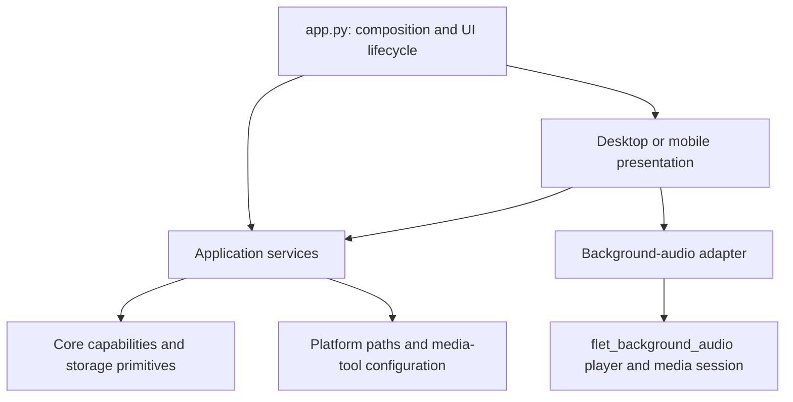

# Architecture and invariants

Melody has a Python application, two Flet presentations, a local Python/Dart
background-audio bridge, native audio players, and an independently selected
runtime yt-dlp wheel. These are separate state owners with explicit handoffs.
Fewer files or fewer lines are not goals if they weaken those boundaries.

## Dependency rules

- `app.py` constructs and connects services and UI controllers. It owns page
  lifecycle integration, but no feature workflow or presentation state.
- `ui/pages/` contains composed feature controllers. Search, library, playlist,
  download, and settings state belongs to its controller rather than the app
  root. Desktop and mobile view builders receive the root only to reach those
  explicit owners and shared application services.
- `ui/components/` contains navigation, utility-panel, player, and shared-view
  collaborators. `MusicPlayerApp` does not inherit from them and does not
  forward their APIs. Immutable library models and media identities may be read
  directly by the UI; mutable capability access goes through application
  services.
- `application/` owns use cases that cross capabilities: download-to-library
  registration, history, queue policy, and playback intent. It must not import
  Flet or a presentation. `downloads.py` coordinates jobs; it does not extract,
  convert, or transfer audio itself.
- `core/` owns independently usable capabilities: downloading, library records,
  canonical media identity, bounded worker pools, and filesystem primitives.
  It must not import application services, UI, the composition root, or platform
  configuration. The application injects native media-tool options.
- `platform_runtime.py` and `runtime_environment.py` are infrastructure leaves.
  New platform concerns should have named modules and explicit dependencies;
  they must not become entry points into application services.
- Desktop and mobile implementations cannot import one another. Shared pages
  contain shared presentation behavior; gestures, shell structure, insets, and
  platform-specific controls belong in the corresponding presentation.
- UI actions run through one page-owned `PageTasks` instance. The action
  decorator accepts a feature controller and schedules it through that
  controller's owning app, so controllers do not own executors or event loops.
- Type-only imports inside `TYPE_CHECKING` do not create runtime dependencies.

`tools/check_architecture.py` runs in the unit suite. It checks absolute and
relative runtime imports, literal dynamic imports, layer direction, opposite
presentation imports, and import cycles. It cannot prove the target of an
arbitrary computed dynamic import; add such imports only with focused tests.

## State ownership

| State | Authority | Other participants |
| --- | --- | --- |
| Durable queue mirror, requested transport, current selection | `PlaybackController` | UI sends commands; native snapshots are persisted |
| Live queue, automatic transitions, decoder/device state | Native playback engine | Adapter forwards track, timeline, and state observations to the controller |
| Track UUIDs, file references, hashes, playlists | `MusicManager` | Application services coordinate registration and deletion |
| Settings, enriched track details, history, session queue | `ApplicationStore` | Writes commit atomically; failure restores in-memory values |
| Worker execution, cancellation, staged download files | `Downloader` | Coordinator acknowledges successful handoff |
| Download reuse, registration, retry, durable operation history | `DownloadCoordinator` | Core does not know about the library |
| Embedded cover artwork | Downloaded media container | Downloader verifies the final tag before committing the file |
| Offline UI artwork keyed by remote URL | `ThumbnailCache` | Derived only from verified embedded bytes; UI and system media resolve cached forms |
| Runtime yt-dlp updates | Explicit updater and its `UpdateResult` | Normal launch and providers use the immutable bundled dependency |

### Playback and concurrency

The controller owns durable Python playback intent and mirrors the native
engine's live queue selection. Its `playing` property is read-only to callers.
It represents requested playback while a load or native command is pending and
is reconciled by native state/error events. It is not proof that the device has
emitted sound. Consumers needing a consistent view can read the immutable
`PlaybackSnapshot`.

Commands, queue mutations, and player callbacks share the controller's reentrant
lock. The controller always gives the complete library path queue to the managed
player. There is no capability probe, Python byte-loading fallback, playback
worker, or Python preload cache. The player owns path validation, candidate
preparation, successor preloading, decoder swaps, and generation-scoped events.
The adapter mounts one managed player service for the page lifetime. Events from
the retiring decoder are ignored, and completion is handled once per generation.
Transport RPCs have their own lock, so Pause remains responsive while a candidate
source is preparing. Callbacks must enqueue UI work or return promptly; do not
wait for another thread that needs the controller lock.

The backend owns transport mechanics and RPC ordering. The native engine owns a
runtime copy of the queue, advances it on completion, preloads its predicted
successor, and emits a generation-scoped track-change event that Python mirrors
and persists. Python must not independently advance a native completion event.
Visible UI queue mutations replace or update the native queue atomically. System
media controls operate that engine directly; only an action that cannot be
satisfied by the installed native queue falls back to Python application policy.
Returning from background queries the native player and reconciles observations.
Suspending a page is not a request to stop playback. Pause preserves the active
media session and exposes Play. On Android, a non-empty resumable queue keeps
the foreground media service attached while paused; only explicit Stop discards
the decoder, releases keep-alive resources, and deactivates system controls.
The native decoder emits position updates once per second in the foreground and
once per five seconds while the UI is hidden. Media-session synchronization
skips unchanged metadata and action sets, leaving only the lightweight playback
timeline correction on background progress ticks.

Android release builds patch the generated launcher activity to `singleTask`
and disable document launching. Launcher and notification intents therefore
route to the existing task rather than constructing a second Python/controller
owner. Within that process, activation is idempotent, the native session stays
mounted across activity detach/reattach, and foreground resume reconciles the
player timeline. Full Android process death still destroys in-memory decoder
identity; the persisted queue can be restored, but automatic continuation is not
claimed. iOS background and lock-screen behavior and Android lifecycle behavior
still require physical-device release testing; the headless suite cannot certify
operating-system policy.

Shuffle is a one-time in-place reorder of the playback queue. Enabling it keeps
the current track fixed and reorders only upcoming rows; starting a collection
with Shuffle reorders the whole collection before selecting its first row.
Next, Previous, repeat, preload prediction, persistence, and the queue UI then
all follow that same visible order without making another random choice.
Playlist order is separately authoritative in `MusicManager`: desktop drag/drop
and mobile move actions persist a strict complete order without replacing or
restarting the active playback queue.

Downloads have a separate bounded worker pool. Coordinator reservations use
canonical source keys under its lock; requests for one source share active
work. Library file allocation, duplicate lookup, and registration are serialized
through `MusicManager.mutation()`, including local imports and download imports.
ApplicationStore serializes each JSON transaction. A data directory is intended
for one application writer; the library is not a multiprocess database.

Thumbnail files written by yt-dlp stay in staging while metadata is written and
the cover is burned into the final audio container. Embedding is the last media
postprocessor. Before promotion, the worker reads the artwork back from every
completed media file; advertised or retained artwork without a readable
embedded cover is a terminal post-processing failure. Mutagen is a direct dependency so this works
for all selectable MP3, M4A, and Opus formats rather than relying on an optional
yt-dlp extra. Only verified embedded bytes are copied into the URL-keyed UI
cache. That derived cache is committed atomically, and a cache failure does not
invalidate the authoritative media file. Flet receives cached bytes directly
and native media sessions receive a file URI, avoiding connectivity probes and
repeated container parsing while offline.

Startup loads only durable state needed for the first view. It does not run the
network updater, fetch development media tools, reconcile unregistered files, or
hash every completed download. Cheap stat-based availability filters the restored
queue and history; full content integrity remains an explicit operation.

## Track identity and files

A library UUID is the durable identity of a saved record. Remote identity is
provider plus stable media ID, represented by `MediaIdentity`; these two
identities have different jobs. YouTube Music and YouTube watch, short, shortened, live, and embed
URLs normalize to `youtube:<media-id>`. Titles and filenames never determine
remote equality. Local files use a content hash for duplicate detection.
The provider ID, display name, accepted hosts, playlist validation, and canonical
YouTube Music URL builders live together in `core.media`; provider, download,
desktop, and mobile modules consume that shared contract instead of maintaining
independent copies.
SearchResult exposes remote identity; queue and playlist entries contain library
UUIDs; core Track and application TrackDetails remain the authoritative models
for their respective fields. Free-form yt-dlp dictionaries stop at provider and
download-adapter boundaries. Download coordination still uses an internal
metadata mapping; it is not a second public track model.

| File class | Owner and lifecycle |
| --- | --- |
| Preview stream | Ephemeral URL; does not create a permanent library track |
| Download staging | Core-owned `.melody-download-*` temporary directory; normal failure/cancellation cleans it |
| Completed, unregistered download | Checksum-bearing `.melody-download-<task UUID>.json` receipt owns the handoff |
| Managed library audio | Referenced by `MusicManager`; desktop files use the selected music folder, while Android files are published through MediaStore to public `Music/Melody` and private staging is removed after an atomic metadata handoff |
| Imported local original | Owned by the user; Melody copies it and never deletes the original |
| Copied import staging | `.melody-import-*.tmp`; atomic rename exposes only complete files |
| Uploaded cookies | Private application storage; explicit upload/remove only |
| Runtime wheels | Updater cache, separate from immutable packaged yt-dlp |

Before completed download files are promoted, core writes a durable receipt with
their final basenames, hashes, source, and task identity. A successful application
registration and history commit acknowledge that receipt. Startup verifies and
replays interrupted handoffs. Malformed, missing, or mismatched handoffs remain
for repair rather than silently adopting unrelated files. Core-only download
consumers must acknowledge the receipt after durably accepting its files.

Cancelling is cooperative. A queued worker can be cancelled immediately; an
active yt-dlp operation stops at a progress hook or the next boundary, so a
network call or converter may delay cancellation. Terminal completion and
cancellation are decided under one lock: cancellation accepted before completion
wins, cleans owned outputs, and publishes one cancelled result. Retrying starts
fresh; partial-download resumability is not promised. Forced process termination
can leave staging directories, which are preserved rather than deleted by an
age-based guess while another process might own them.

## Crash consistency and recovery

Settings, library metadata, cookies, update state, and download receipts use
temporary writes, file flush/fsync, atomic replacement, and directory fsync where
supported. Audio promotion happens on the destination filesystem; local imports
copy to a temporary file there first. This avoids partial final files, but cannot
promise durability beyond the filesystem/device's guarantees.

The binary library and JSON state are separate stores, not a distributed
transaction. Startup removes stale secondary references, marks completed history
with missing audio as repairable, replays verified download receipts, and prunes
missing queue files. Missing track records remain available for source-based
repair. Unregistered local files are reported and preserved. A local-import
process kill or a failed deletion can still leave an unregistered file; automatic
deletion without a durable ownership record is deliberately unsupported.

Failure categories are network, authentication/cookies, unavailable media,
extractor incompatibility, rate limit, disk, cancellation, unsupported URL, and
unknown. Core results carry the category and recovery action; download history
persists them. Recovery is user initiated: there is no automatic retry storm.
Rate limits require waiting; cookie failures require refreshed credentials;
storage errors require capacity/permission repair. Provider messages and download
results should use this shared vocabulary as new providers are added.

## Remaining engineering work

- Native session reattachment after process/page recreation and physical-device
  lifecycle tests.
- A complete locked Flutter/native transitive dependency graph for each release
  target; pinning Python packages and bridge dependencies alone is insufficient
  for byte-for-byte reproducible native artifacts.
- Durable deletion/local-import journals if automatic cleanup of their crash
  leftovers is required, and multiprocess locking if simultaneous app writers
  become a supported feature.
- Splitting platform infrastructure by capability when it gains new concerns;
  avoid moving files purely to reduce directory size.
