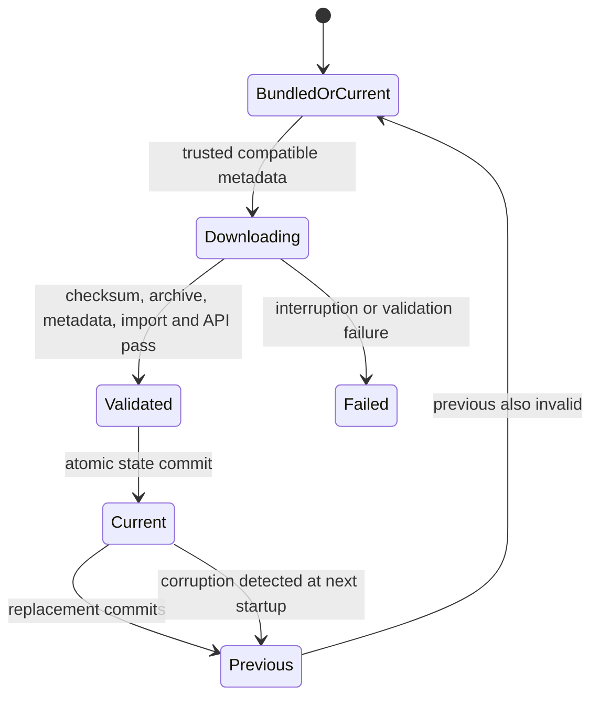

# Release and dependency policy

## One release version

`version:` in `app/pubspec.yaml` is authoritative and must match the release tag
being cut. It has the form `X.Y.Z+BUILD`, and the build number must equal
`major * 1_000_000 + minor * 1_000 + patch` (minor and patch below 1000, major
at most 2099); `tools/release_version.py` rejects anything else, and rejects a
tag that is not exactly `v<version>`. Every published build needs a new
version, because rebuilding the same version does not create a new Android
version code. `tools/build_app.py` passes the version and build number to
`flutter build` explicitly.

1. Change the version line and dependency pins when needed.
2. Refresh lock files (`flutter pub get`, `uv lock` in `worker/` and the root),
   run validation, and review compatibility changes together.
3. Build through `tools/build_app.py` from a clean checkout.
4. Tag exactly `v<version>` to run the release workflow.

## Identity

Melody's Flet releases shipped as `com.flet.musicplayer` (Flet's default
organization plus the project name). The Flutter app keeps that application ID
and bundle identifier, and the same signing key must be used, so installs
upgrade in place and keep their data directory. Do not change it.

## Components

| Component | Pinned in | Tested baseline |
| --- | --- | --- |
| Flutter / Dart | CI `FLUTTER_VERSION` | 3.44.8 / 3.12 |
| serious_python | `app/pubspec.yaml` | 4.5.1 (platform packages 4.7.2) |
| Embedded CPython | `tools/build_app.py` `PYTHON_VERSION` | 3.14 |
| Bundled yt-dlp | `worker/pyproject.toml` + `worker/uv.lock` | 2026.8.19, exact |
| just_audio / audio_session / just_audio_media_kit | `packages/melody_audio/pubspec.yaml` | 0.10.6 / 0.2.4 / 2.1.0, exact |
| media_kit Windows audio / Linux libraries | `packages/melody_audio/pubspec.yaml` | 1.0.9 / 1.2.1, exact |
| flutter_media_session | `packages/melody_audio/pubspec.yaml` | 3.0.3, exact |
| FFmpeg | `tools/fetch_media_binaries.py` | provider SHA-256 verified on every fetch |

The worker is packaged with exactly the requirements in `worker/uv.lock`
(`uv export --frozen --no-dev`). Its own source ships as plain Python; its
dependencies are compiled to bytecode.

`flutter_media_session` still includes `<experimental/coroutine>`, which current
MSVC rejects. `app/windows/CMakeLists.txt` defines
`_SILENCE_EXPERIMENTAL_COROUTINE_DEPRECATION_WARNINGS` for all targets, as
Flet's template did; remove it once the plugin moves to C++20 coroutines.

Native builds also involve Flutter, platform SDKs, and transitive Dart and
native packages; artifacts are not claimed to be bitwise reproducible.

## Runtime yt-dlp selection

The bundled yt-dlp is immutable. Runtime wheels are stored under the app data
directory's `yt-dlp-runtime` and never replace the bundled distribution. The
accepted update window is `>=2026.8.19,<2027`, defined in
`worker/src/melody_worker/updater.py`; changing it requires a reviewed change
and extractor/download regression tests.

The worker selects its runtime once per launch, before yt-dlp is first
imported, and reports the result in its `ready` event. A normal launch is
offline: it re-validates installed wheels and activates `current`, or uses the
bundled package. It holds a session lock for the process lifetime; a second
process that cannot acquire it uses the bundled package without changing the
cache. Any selection failure is a diagnostic, never a startup error.

Settings → Maintenance asks the worker for PyPI metadata on demand. Installing
a newer release records a request in the application store; the next launch
consumes it once and starts the worker with the remote check enabled, so the
download, validation, import probe, and rollback all happen before the first
import. Changing the selected runtime requires a restart.

State schema 2 contains `current`, `previous`, `pending`, and `failed` records;
each wheel record holds version, basename, and SHA-256. `pending.status` is
`downloading` or `validated`. Invalid state never grants trust to directory
contents.

Metadata and wheel downloads use HTTPS with size limits, wheel URLs must be on
PyPI's file host, and yanked wheels are rejected. Wheels must match the trusted
SHA-256, pass ZIP integrity and path checks, contain the expected distribution
and version, and satisfy Python and dependency constraints. Inside the embedded
interpreter the import probe runs in-process during startup and cleans up its
temporary imports. Failed validation quarantines that version and checksum;
transient download failures can retry on a later launch.
